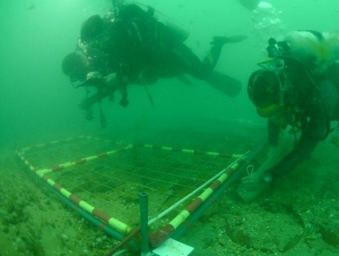

# 🌊 AquaVision AI — Deep Learning Underwater Image Enhancement & Marine Scene Analysis System

<p align="center">
  
</p>

<p align="center">
  <b>A comprehensive AI platform for optical underwater restoration, subsea video anti-flicker enhancement, marine biological species detection (YOLOv8), coral reef bleaching assessment, and automated engineering inspection reports.</b>
</p>

<p align="center">
  
  
  
  
  
  
  
</p>

---

## 📌 Table of Contents
1. [Executive Overview](#-executive-overview)
2. [Key Capabilities & Innovations](#-key-capabilities--innovations)
3. [Optical Physics Degradation Model](#-optical-physics-degradation-model)
4. [Multi-Dataset Inventory](#-multi-dataset-inventory)
5. [Model Architecture & Checkpoints](#-model-architecture--checkpoints)
6. [System Architecture](#-system-architecture)
7. [Installation & Quickstart](#-installation--quickstart)
   - [Hardware & Software Prerequisites](#prerequisites)
   - [Backend Setup (FastAPI & PyTorch)](#1-backend-setup)
   - [Frontend Setup (Next.js & React)](#2-frontend-setup)
8. [Usage Guide](#-usage-guide)
9. [API Reference](#-api-reference)
10. [Scientific Evaluation Metrology](#-scientific-evaluation-metrology)
11. [Academic Attribution & Team](#-academic-attribution--team)

---

## 🔍 Executive Overview

Light propagating through underwater environments undergoes severe exponential wavelength attenuation and scattering:
- **Red Wavelength Absorption**: Red light (650–700 nm) is completely absorbed within 3–5 meters of depth, leading to strong greenish-cyan color casts.
- **Forward & Backward Scattering**: Floating organic particles ("marine snow") scatter ambient illumination into random angles, reducing contrast and producing veiling glare.

**AquaVision AI** resolves these optical degradations through a hybrid computer vision and deep learning platform featuring:
- **AquaVisionNet**: Residual Attention U-Net with Squeeze-and-Excitation (SE) channel recalibration.
- **Guided Bilateral Upsampling**: Edge-preserving high-resolution processing (1080p/4K) without memory exhaustion.
- **Marine Biological Intelligence**: Real-time YOLOv8 taxonomy bounding boxes and CIELAB coral bleaching health indexes.
- **Subsea Video Pipeline**: Exponential Moving Average (EMA) anti-flicker temporal stabilization.
- **Batch Survey & Reporting**: Automated multi-page PDF Marine Inspection Reports with faculty supervisor sign-off blocks.

---

## ✨ Key Capabilities & Innovations

- **🚀 Deep Learning Optical Restoration**: Residual Attention U-Net trained on 19,000+ real and synthesized marine image pairs.
- **🛡️ Zero-Downtime Classical Fallback**: Gray-World White Balance + CLAHE in LAB space for instant execution if GPU/weights are absent.
- **🎯 YOLOv8 Marine Bio-Intelligence**: Automated detection and classification of marine fauna (fish, turtles, sharks), corals, divers, and marine debris with high-tech HUD overlays.
- **🪸 Coral Reef Bleaching Metrology**: CIELAB/HSV colorimetric analysis computing Bleaching Index (0.0 to 1.0), benthic coverage, algal overgrowth, and scientific survey advisories.
- **🎬 Subsea Video Anti-Flicker Processing**: Temporal EMA smoothing ($I_t' = (1-\alpha)\hat{I}_t + \alpha I_{t-1}'$) that eliminates frame flickering in underwater video streams.
- **📦 Batch Survey & ZIP Packaging**: Drag-and-drop batch queue, processing telemetry, and one-click ZIP exports containing enhanced images, annotated HUD frames, and JSON metadata.
- **📄 Official Marine Inspection PDF Reports**: Automated ReportLab PDF generator containing side-by-side photographic evidence, quantitative metrics tables, and formal engineering verification blocks.
- **📊 Quantitative Benchmark Suite**: Automated evaluation across UIEB, LSUI, and EUVP with real-time UI charts, CSV exports, and publication-ready LaTeX tables.
- **🔄 Dynamic Checkpoint Switcher**: Live switching between specialized checkpoints (`model.pth`, `model_lsui.pth`, `model_euvp.pth`, `model_combined.pth`).

---

## 🌊 Optical Physics Degradation Model

Underwater image formation follows the Jaffe-McGlamery optical model:

$$E(x, \lambda) = J(x, \lambda) \cdot t(x, \lambda) + B_\infty(\lambda) \cdot (1 - t(x, \lambda))$$

Where:
- $J(x, \lambda)$ represents the true, unattenuated scene radiance.
- $t(x, \lambda) = e^{-\beta(\lambda) d(x)}$ represents the wavelength-dependent transmission map across distance $d(x)$.
- $B_\infty(\lambda)$ is the background veiling waterlight.
- $\beta(\lambda) = a(\lambda) + b(\lambda)$ is the total attenuation coefficient (absorption + scattering).

AquaVisionNet learns to invert this non-linear function by dynamically recalibrating color channels and restoring structural contrast.

---

## 📊 Multi-Dataset Inventory

AquaVision supports multi-dataset training and evaluation across 19,019 underwater image pairs:

| Dataset | Image Pairs | Domain & Environmental Scope | Output Weights |
| :--- | :--- | :--- | :--- |
| **UIEB** | 800 Train / 90 Val | Diverse coastal and blue deep-sea waters with volunteer ground truths | `weights/model.pth` |
| **LSUI** | 3,851 Train / 428 Val | Turbid, green-tinted, benthic coral reef ecosystems | `weights/model_lsui.pth` |
| **EUVP** | 12,465 Train / 1,385 Val | ROV abyssal explorations, dark waters, ImageNet underwater subsets | `weights/model_euvp.pth` |
| **AquaVision-Unified** | **19,019 Combined Pairs** | All marine water types and lighting conditions | `weights/model_combined.pth` |

*Note: All raw/ground-truth dataset images in `backend/dataset/` are excluded from Git via `.gitignore`.*

---

## 🧠 Model Architecture & Checkpoints

### 1. AquaVisionNet Architecture
- **Input / Output**: $256 \times 256 \times 3$ RGB tensor normalized to $[-1, 1]$.
- **Encoder**: 4 downsampling stages with Residual blocks and **Squeeze-and-Excitation (SE)** modules that reweight channel contributions based on global receptive fields.
- **Bottleneck**: Deep residual attention blocks capturing multi-scale context.
- **Decoder**: 4 upsampling stages with skip connections restoring spatial edge details and high-frequency textures.
- **Loss Function**: Hybrid combination of $L_1$ pixel loss, Mean Squared Error (MSE), and Structural Similarity (SSIM):
  $$\mathcal{L}_{\text{total}} = 0.5 \cdot \mathcal{L}_{1} + 0.2 \cdot \mathcal{L}_{\text{MSE}} + 0.3 \cdot (1 - \text{SSIM})$$

### 2. Guided Bilateral Upsampling (High-Resolution Pipeline)
To process 1080p and 4K images on hardware with 4 GB VRAM:
1. Low-resolution tensor ($256 \times 256$) is enhanced via AquaVisionNet.
2. Color chrominance channels are upscaled via Lanczos-4 interpolation.
3. Luminance channel is refined by fusing high-pass structural edge gradients extracted from the original high-resolution input, eliminating interpolation ringing.

---

## 🏗️ System Architecture

```
┌────────────────────────────────────────────────────────────────────────┐
│                   Next.js 16 Client (React & Tailwind)                 │
│  [Single Image]  |  [Subsea Video (EMA)]  |  [Batch Survey Processing]  │
│  - Split Slider Viewer       - Anti-Flicker GPU       - ZIP Archive    │
│  - Biological HUD Toggle     - Side-by-Side Video     - Survey PDF     │
│  - Checkpoint Switcher       - Benchmark Modal        - System Specs   │
└───────────────────────────────────┬────────────────────────────────────┘
                                    │ HTTP Multipart / JSON REST
                                    ▼
┌────────────────────────────────────────────────────────────────────────┐
│                        FastAPI Backend Server                          │
│  (/upload, /video, /batch, /batch/zip, /batch/report, /models, /detect) │
└─────────────────┬───────────────────┬───────────────────┬──────────────┘
                  │                   │                   │
                  ▼                   ▼                   ▼
        ┌──────────────────┐ ┌──────────────────┐ ┌──────────────┐
        │  AquaVisionNet   │ │  YOLOv8 Marine   │ │  ReportLab   │
        │ Residual Attention│ │  Detector & Coral│ │  Inspection │
        │  U-Net (PyTorch) │ │ Health Analyzer  │ │ PDF Generator│
        └──────────────────┘ └──────────────────┘ └──────────────┘
```

---

## 🚀 Installation & Quickstart

### Prerequisites
- **Operating System**: Windows 10/11, Ubuntu 20.04+, or macOS
- **Python**: 3.10+ (Recommended: PyTorch 2.6 with CUDA support)
- **Node.js**: 18.0+ & **npm**
- **GPU (Optional)**: NVIDIA GPU with CUDA 12+ (e.g., NVIDIA GeForce RTX 3050 Laptop GPU, 4 GB VRAM)

---

### 1. Backend Setup

```bash
# 1. Clone the repository
git clone https://github.com/Piyush851/AquaVision.git
cd AquaVision/backend

# 2. Create and activate virtual environment
python -m venv venv

# Windows:
venv\Scripts\activate
# Linux/macOS:
source venv/bin/activate

# 3. Install dependencies
pip install -r requirements.txt

# 4. Start the FastAPI server
python app/main.py
```
Backend runs at **`http://localhost:8000`** (Swagger docs: `http://localhost:8000/docs`).

---

### 2. Frontend Setup

```bash
# 1. Navigate to frontend directory
cd ../frontend

# 2. Install dependencies
npm install

# 3. Start development server
npm run dev
```
Open **`http://localhost:3000`** in your browser.

---

## 💻 Usage Guide

### 1. Single Image Restoration
- Upload any underwater photograph or click one of the 4 benchmark presets.
- Drag the **split-screen slider** to inspect before/after color restoration and contrast recovery.
- Click **"Biological Overlay"** to view real-time YOLOv8 bounding boxes and coral reef health tags.
- Click **"Generate PDF Report"** to download an engineering inspection report.

### 2. Subsea Video Enhancement
- Select the **"Subsea Video Enhancement"** tab.
- Drag and drop a subsea video file (`.mp4`, `.mov`, `.avi`, `.webm` up to 50 MB).
- Toggle side-by-side composite mode and click **"Enhance Subsea Video"**.

### 3. Batch Survey Processing
- Select the **"Batch Survey Processing"** tab.
- Drop multiple images or click **"+ Load 4 Benchmark Samples"**.
- Click **"Run Batch Pipeline"**.
- View aggregate statistics (mean PSNR gain, UIQM, organism count) and download a single **ZIP Archive** or **Official Survey PDF**.

### 4. Dynamic Model Switching
- Click the **"Model"** button in the navigation header.
- Switch between `model_combined.pth` (Unified), `model_lsui.pth` (Turbid reefs), `model_euvp.pth` (Abyssal), and `model.pth` (UIEB).

---

## 🔌 API Reference

| Endpoint | Method | Description |
| :--- | :---: | :--- |
| `/api/v1/enhance/upload` | `POST` | Upload and enhance single image (`multipart/form-data`) |
| `/api/v1/enhance/detect/{file_id}` | `POST` | Run YOLOv8 marine detection & coral bleaching analysis |
| `/api/v1/enhance/report/{file_id}` | `POST` | Generate individual formal engineering PDF report |
| `/api/v1/enhance/video` | `POST` | Process subsea video with temporal anti-flicker EMA |
| `/api/v1/enhance/batch` | `POST` | Batch process multiple frames with metrics & biological detection |
| `/api/v1/enhance/batch/zip` | `POST` | Download structured ZIP package (enhanced, HUD, metadata JSON) |
| `/api/v1/enhance/batch/report` | `POST` | Generate official multi-page Marine Survey PDF report |
| `/api/v1/enhance/models` | `GET` | List available model checkpoints and active weights |
| `/api/v1/enhance/switch-model` | `POST` | Hot-swap active neural network checkpoint |
| `/api/v1/enhance/benchmark` | `GET` | Retrieve quantitative benchmark metrology results |
| `/api/v1/enhance/benchmark/export/csv` | `GET` | Export benchmark comparison matrix as CSV |
| `/api/v1/enhance/benchmark/export/latex`| `GET` | Export publication-ready LaTeX table |

---

## 📈 Scientific Evaluation Metrology

AquaVision employs both full-reference and no-reference optical quality metrics:

1. **PSNR (Peak Signal-to-Noise Ratio)**:
   $$\text{PSNR} = 10 \cdot \log_{10}\left(\frac{\text{MAX}_I^2}{\text{MSE}}\right)$$
2. **SSIM (Structural Similarity Index)**: Evaluates luminance, contrast, and structural preservation.
3. **UIQM (Underwater Image Quality Measure)**:
   $$\text{UIQM} = c_1 \cdot \text{UICM} + c_2 \cdot \text{UISM} + c_3 \cdot \text{UIConM}$$
   *(UICM: Colorfulness, UISM: Sharpness, UIConM: Contrast)*
4. **UCIQE (Underwater Color Image Quality Evaluation)**:
   $$\text{UCIQE} = c_1 \cdot \sigma_c + c_2 \cdot \text{con}_l + c_3 \cdot \mu_s$$
   *(Chroma standard deviation, luminance contrast, saturation mean)*

---

## 👥 Academic Attribution & Team

### Engineering College, Ajmer (Bikaner Technical University)
**Department of Information Technology — Final Year Project (2026–2027)**  
**Project Supervisor:** Mrs. Bhanupriya Sharma (Assistant Professor, Dept. of CSE & IT)

| Team Member | Roll Number | Role Focus & Primary Responsibilities |
| :--- | :--- | :--- |
| **Piyush Saini** | `23EEAIT043` | **Role 2: Team Lead & Computer Vision Specialist / Optical Engineer**<br/>• Guided bilateral upsampling (high-res edge preservation)<br/>• Non-reference optical metrics (UIQM, UCIQE, PSNR)<br/>• Subsea video anti-flicker EMA pipeline<br/>• Automated Marine PDF Inspection Report Generator<br/>• Multi-dataset training execution & Batch Processor |
| **Piyush Balundiya** | `23EEAIT042` | **Role 1: Core ML Architect & Model Engineer**<br/>• AquaVisionNet (Residual Attention U-Net + SE Attention)<br/>• YOLOv8 Marine species object detector<br/>• Coral reef bleaching/health classifier<br/>• Model export: ONNX Runtime & TorchScript |
| **Kumkum Dadhich** | `23EEAIT039` | **Role 3: MLOps Engineer & Dataset Specialist**<br/>• Data augmentation pipelines (Albumentations)<br/>• Benchmark evaluation scripts & comparative CSV logs<br/>• Ingestion of UIEB, LSUI, and EUVP datasets |
| **Vishwas Sharma** | `23EEAIT049` | **Role 4: REST API & Backend Systems Engineer**<br/>• Asynchronous FastAPI endpoints & CORS configuration<br/>• Docker containerization & API reliability |

---

## 📄 License

This project is licensed under the [MIT License](LICENSE).
